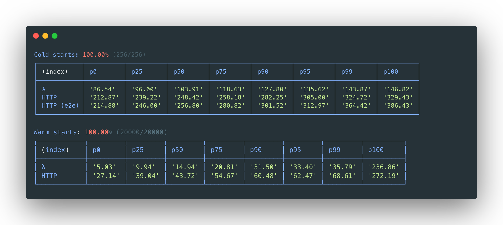
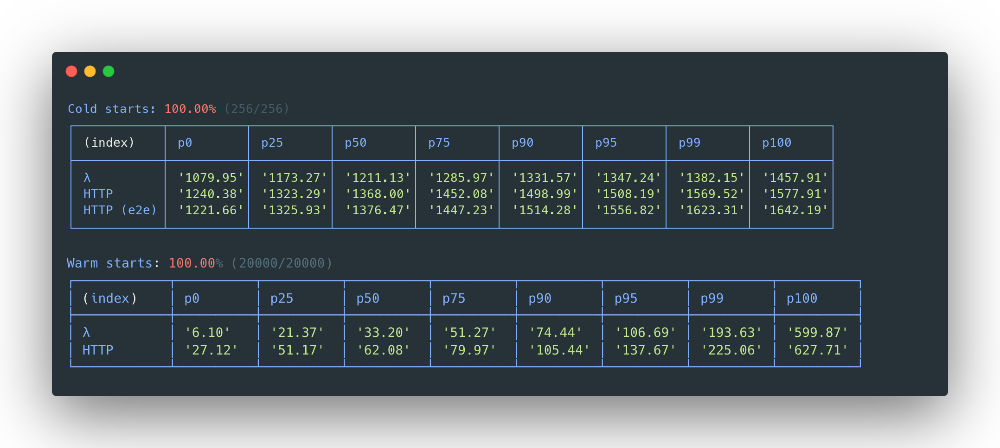

# LLRT

 

LLRT (**L**ow **L**atency **R**un**t**ime) is a lightweight JavaScript runtime designed to address the growing demand for fast and efficient Serverless applications. LLRT offers up to over **10x** faster startup and up to **2x** overall lower cost compared to other JavaScript runtimes running on **AWS Lambda**

It's built in Rust, utilizing QuickJS as JavaScript engine, ensuring efficient memory usage and swift startup.

!!! warning
    LLRT is an **experimental** package. It is subject to change and intended only for evaluation purposes.

LLRT - [DynamoDB Put, ARM, 128MB](https://github.com/awslabs/llrt/blob/main/example/functions/src/v3-lib.mjs)

Node.js 20 - [DynamoDB Put, ARM, 128MB](https://github.com/awslabs/llrt/blob/main/example/functions/src/v3-lib.mjs)

HTTP benchmarks measured in **round trip time** for a cold start ([why?](benchmarks.md))

## Quick start

Download the latest LLRT release from <https://github.com/awslabs/llrt/releases>. For a Lambda function, choose `Custom Runtime on Amazon Linux 2023` and package the LLRT `bootstrap` binary together with your JavaScript code. See [Install and deploy](install.md) for layers, container images, AWS SAM and AWS CDK.

!!! important
    Even though LLRT supports [ES2023](https://262.ecma-international.org/14.0/) it's **NOT** a drop in replacement for Node.js. Consult the [Compatibility](compatibility.md) page and the [API](https://github.com/awslabs/llrt/blob/main/API.md) reference for more details.
    All dependencies should be bundled for a `browser` platform and mark included `@aws-sdk` packages as external. See [Dependencies](dependencies.md).

## Rationale

What justifies the introduction of another JavaScript runtime in light of existing options such as [Node.js](https://nodejs.org/en), [Bun](https://bun.sh) & [Deno](https://deno.com/)?

Node.js, Bun, and Deno represent highly proficient JavaScript runtimes. However, they are designed with general-purpose applications in mind. These runtimes were not specifically tailored for the demands of a Serverless environment, characterized by short-lived runtime instances. They each depend on a ([Just-In-Time compiler (JIT)](https://en.wikipedia.org/wiki/Just-in-time_compilation) for dynamic code compilation and optimization during execution. While JIT compilation offers substantial long-term performance advantages, it carries a computational and memory overhead.

In contrast, LLRT distinguishes itself by not incorporating a JIT compiler, a strategic decision that yields two significant advantages:

A) JIT compilation is a notably sophisticated technological component, introducing increased system complexity and contributing substantially to the runtime's overall size.

B) Without the JIT overhead, LLRT conserves both CPU and memory resources that can be more efficiently allocated to code execution tasks, thereby reducing application startup times.

## Limitations

There are many cases where LLRT shows notable performance drawbacks compared with JIT-powered runtimes, such as large data processing, Monte Carlo simulations or performing tasks with hundreds of thousands or millions of iterations. LLRT is most effective when applied to smaller Serverless functions dedicated to tasks such as data transformation, real time processing, AWS service integrations, authorization, validation etc. It is designed to complement existing components rather than serve as a comprehensive replacement for everything. Notably, given its supported APIs are based on Node.js specification, transitioning back to alternative solutions requires minimal code adjustments.

## Security

See [CONTRIBUTING](https://github.com/awslabs/llrt/blob/main/CONTRIBUTING.md#security-issue-notifications) for more information.

## License

This library is licensed under the Apache-2.0 License. See the [LICENSE](https://github.com/awslabs/llrt/blob/main/LICENSE) file.
